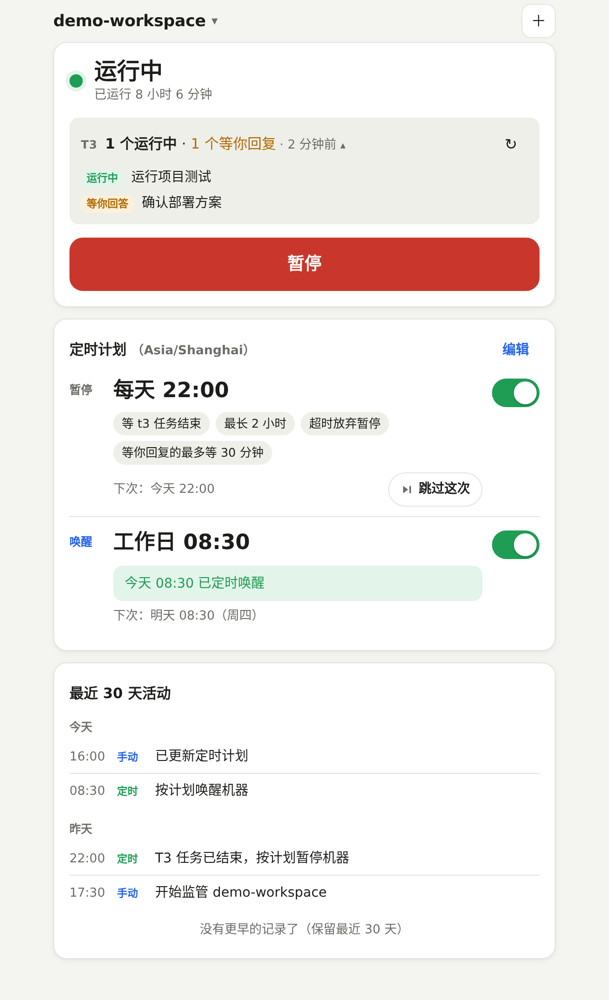
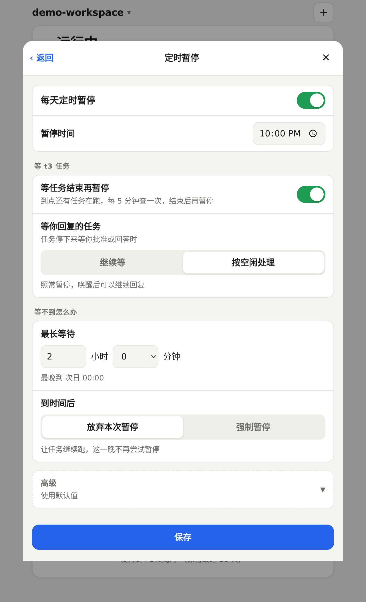

# Instabox 监管社区版

[](https://deploy.workers.cloudflare.com/?url=https://github.com/othorizon/instabox-monitor-ce)

部署在 Cloudflare Workers 上的 Instabox 机器监管面板，通过 Cloudflare Access 控制访问。

- 查看机器状态、t3 任务情况，一键暂停或唤醒
- 每天定时暂停：可以等 t3 任务结束再暂停，并设置最长等待时间和超时后的处理方式；可以“跳过这次”
- 定时唤醒：每天、工作日或自选星期，到点唤醒已暂停或停止的机器
- 首页的定时计划卡片上可以直接开关定时暂停和定时唤醒，立即生效，可撤销
- 最近 30 天的活动记录，包括手动操作、定时暂停和外部状态变化

## 界面截图

截图使用演示数据。点击图片可查看原图。

| 机器总览 | 定时暂停设置 |
| --- | --- |
| <a href="docs/screenshots/overview.png"></a> | <a href="docs/screenshots/scheduled-pause.png"></a> |

## 工作方式

| 组件 | 作用 |
|---|---|
| Worker `/api/*` | 页面使用的 API，每个请求都会校验 Cloudflare Access JWT |
| Cron `* * * * *` | 每分钟读取一次机器状态，记录外部状态变化，推进定时暂停状态机 |
| D1 | 保存机器列表、暂停配置、每晚的执行记录和活动记录 |
| instabox API | `GET /v1/machines/{id}`（不会唤醒机器）、`suspend`、`resume`/`start`、`exec` |

**判断 t3 任务**：通过 `exec` 在机器上运行 `python3`，以只读方式查询 `~/.t3/userdata/statev2.sqlite`：

- `orchestration_v2_projection_runs.status` 为 `queued` / `preparing` / `starting` / `running` / `waiting`：线程有进行中的任务
- 同一线程在 `orchestration_v2_projection_runtime_requests` 里有 `status = 'pending'` 的记录：任务停下来等你处理，`kind` 含 `approval` 是等你批准，其余（如 `user_input`）是等你回答；`created_at` 是开始等你的时间
- `runs.completed_at` 的最大值：最近一次任务结束的时间

这些是 t3 的内部表，已在 t3 0.1.9 上验证。如果检测失败，按“有任务”处理，由最长等待时间兜底。

**定时暂停流程**（每台机器每晚一条执行记录）：

1. 到达暂停时间时，如果机器已经暂停或停止，直接记为完成。
2. 如果关闭了“等 t3 任务结束再暂停”，立即暂停。
3. 否则每 5 分钟检测一次 t3：
   - 没有运行中的任务就暂停。“等你回复”的任务默认按空闲处理；选“继续等”后，这类任务也算运行中，这一轮不暂停，5 分钟后再查。
   - 高级设置（都是“至少”，满足后的下一次检查才暂停，不会为此增加检查）：
     - 任务结束后至少再等（默认 10 分钟）：最后一个任务结束不满这个时间，这一轮不暂停。
     - 等你回复至少满（默认 30 分钟，按空闲处理时才生效）：有任务开始等你不满这个时间，这一轮不暂停。
   - 到达最长等待时间时还有任务，按配置处理：“放弃本次暂停”（默认，今晚不再尝试），或“强制暂停”。
4. 每晚只执行一次。自动暂停之后你手动唤醒机器，当晚不会再被暂停。
5. **跳过这次**：提前把下一次暂停记为 `skipped`；正在等待时跳过，就是结束当前这次等待。撤销即删除这条记录：
   还没到点就照常执行；已到点、仍在最长等待时间内，下一分钟重新开始等待。

**定时唤醒**（默认开启，工作日 08:30）：

- 到点后 5 分钟内触发一次（只为容忍 Cron 抖动），每台机器每天最多一次；错过不补。
- 已暂停 → resume，已停止 → start，已在运行 → 跳过；处于 instabox 冷却期 → 记一条失败，不重试。
- 唤醒时如果当晚的定时暂停还在等 t3 任务，就结束等待，不再暂停。
- 唤醒后如果没人用，instabox 的空闲自动暂停仍会生效，本服务不处理。

**注意**：`exec` 会被 instabox 当作机器活动，重置空闲自动暂停的计时。所以只在等待期间或你手动点刷新时才检测 t3，打开页面不会自动触发检测。

## 部署

### 一键部署到 Cloudflare

1. 点击页面顶部的 **Deploy to Cloudflare**，登录 Cloudflare 并连接 GitHub。
2. 在部署页面确认 Worker 和 D1 数据库名称。数据库可以改名，绑定名保留 `DB`。用你的 Instabox API Key 填写 `INSTABOX_API_KEY`。它会作为 Worker Secret 保存。
3. 保留默认识别到的构建命令 `npm run build` 和部署命令 `npm run deploy`。Cloudflare 会创建 D1 并用真实 ID 更新新仓库中的 Wrangler 配置。构建先生成前端资源和 Worker 的部署配置，部署命令再通过 `DB` 绑定运行 SQL 迁移，成功后发布 Worker。

后续提交到部署仓库的生产分支也会按这个顺序构建和部署。Wrangler 只应用尚未记录的迁移。

### 配置登录

一键部署完成后，选择一个访问域名，并为它启用 [Cloudflare Access](https://developers.cloudflare.com/workers/configuration/cloudflare-access/)。

- **workers.dev**。模板默认启用 `workers.dev`。在 Workers & Pages 中打开这个 Worker 的 **Access** 页，启用 **Protect this Worker behind Access**，范围选择 **All traffic**。也可以在 Zero Trust 中为这个 `workers.dev` 主机名创建 Self-hosted 应用。
- **自定义域名**。在部署生成的仓库中，将 `workers_dev` 设为 `false`，并在 `wrangler.jsonc` 添加 `"routes": [{ "pattern": "monitor.example.com", "custom_domain": true }]`。为这个域名创建 Zero Trust Self-hosted 应用，然后提交配置触发部署。

在 Zero Trust 的 **Access → Applications** 中找到对应应用，为允许登录的邮箱或用户组配置 **Allow** 策略。从应用设置复制 **Application Audience (AUD) Tag**。在 Worker 的 **Settings → Variables and Secrets** 中添加以下文本变量。

| 变量 | 值 |
| --- | --- |
| `ACCESS_TEAM_DOMAIN` | 你的 Zero Trust 团队域名，例如 `myteam.cloudflareaccess.com` |
| `ACCESS_AUD` | 上面 Access 应用的 AUD Tag |
| `ALLOWED_EMAILS` | 可选，逗号分隔的邮箱列表，用于在 Worker 内再做一层限制 |

Worker API 要求有效的 Access JWT。团队域名或 AUD 缺失时，API 会拒绝请求。后续部署会保留控制台配置的变量。

### 手动部署

如果使用 Wrangler CLI，先安装依赖并创建自己的 D1 数据库。

```sh
npm ci
npx wrangler d1 create instabox-monitor-ce
```

在自己的 `wrangler.jsonc` 中用真实的 `database_id` 替换全零占位符。如果更改数据库名称，同步更新 `database_name`，保留 `DB` 绑定名。用具有 `machines:read` 和 `machines:write` 权限的 Instabox API Key 设置 Worker Secret，然后构建并部署。`npm run deploy` 会先应用远程迁移。

```sh
npx wrangler secret put INSTABOX_API_KEY
npm run build
npm run deploy
```

按上面的步骤配置 Cloudflare Access 登录。公开仓库的配置保留占位符。

## 本地开发

```sh
npm ci
cp .dev.vars.example .dev.vars   # 填入你的 INSTABOX_API_KEY
printf '%s\n' 'DEV_SKIP_ACCESS=1' >> .dev.vars   # 仅用于本地，跳过 Access 校验
npm run db:migrate:local
npm run dev                       # http://localhost:5173
```

开发服务器启动后，在另一个终端运行 `curl localhost:5173/cdn-cgi/handler/scheduled` 可手动触发一次 Cron。运行 `npm test` 可执行测试。

`.dev.vars` 里可以用 `INSTABOX_API_URL` 指向一个模拟的 API 服务。

## 许可证

[MIT](LICENSE)
